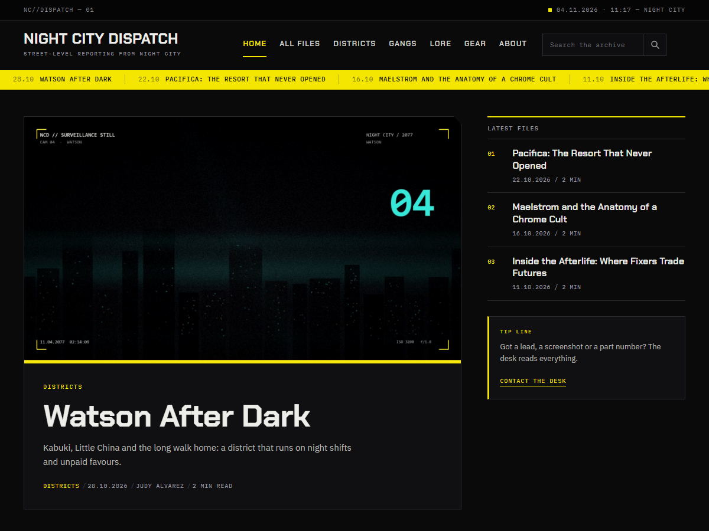

# Night City Dispatch

A classic WordPress theme built for an in-world fan magazine about Night City. Hazard yellow on ink, condensed display type, mono data labels and an off-white paper reading surface: the design language of a municipal terminal rather than a generic blog.



Built for the **WordPress Custom 1** module: a hand-built theme that follows the WordPress template hierarchy, pulls all content dynamically through the Loop, and ships reusable header/footer parts plus a `functions.php`.

## What is included

| Requirement | Implementation |
| --- | --- |
| Front page | `front-page.php` — lead story, latest six files, section index, desk note |
| Single post | `single.php` — featured image, file metadata, author box, tags, related files, comments |
| Static page | `page.php` |
| 404 | `404.php` — search form plus recent files |
| Filtering / archives | `archive.php`, `author.php`, `search.php` and a filter bar with category, tag and author links |
| Reusable header & footer | `header.php`, `footer.php` |
| `functions.php` | theme supports, menus, image sizes, assets, archive query, template helpers |

Extra templates: `home.php` (blog index), `category.php` / `tag.php` are handled by `archive.php`, `searchform.php`, `comments.php`, `template-parts/`.

## Template hierarchy in this theme

| URL | Template used |
| --- | --- |
| `/` | `front-page.php` |
| `/index/` (posts page) | `home.php` |
| `/relic-job/` | `single.php` |
| `/about/` | `page.php` |
| `/category/districts/` | `archive.php` |
| `/tag/watson/` | `archive.php` |
| `/author/judy/` | `author.php` |
| `/?s=relic` | `search.php` |
| anything missing | `404.php` |
| fallback | `index.php` |

## Install

1. Download `night-city-dispatch.zip`.
2. WordPress dashboard → Appearance → Themes → Add New → Upload Theme → activate.
3. Appearance → Menus: create a menu and assign it to **Primary menu**.
4. Settings → Reading: the theme works with either "latest posts" or a static front page. This demo uses a static front page (`/`) plus a posts page (`/index/`).
5. Optional: Appearance → Customize → Site Identity for a logo.

Demo content is not bundled with the theme (it lives in the local WordPress install used to build it), so a fresh install starts with the theme's empty states and the filter bar built from whatever content exists.

## How it works

- **The Loop** — every listing (`front-page.php`, `home.php`, `archive.php`, `author.php`, `search.php`) runs `while ( have_posts() ) : the_post();` and offloads the card markup to `template-parts/content-card.php`.
- **Custom queries** — `WP_Query` is used for the lead story, the "latest" grid, related posts and the 404 list. `wp_reset_postdata()` is called after each secondary loop.
- **Dynamic content** — `the_title()`, `the_content()`, `the_permalink()`, `the_post_thumbnail()`, `get_the_category()`, `get_the_tags()`, `get_the_date()`, `get_the_author_meta()`, `get_avatar()`, `the_archive_description()`, `paginate_links()` via `the_posts_pagination()`.
- **Filtering** — the chips in `inc/template-tags.php` link to real category, tag and author archives. Filtering therefore works without JavaScript, every state has a shareable URL, and the active chip is marked with `aria-current="page"`.
- **functions.php** — registers `title-tag`, post thumbnails, custom logo, HTML5 markup, two menus and three image sizes; enqueues bundled fonts, the stylesheet and a small progressive-enhancement script; sets six posts per page on archives; adds reading time, word count, meta, related posts, pagination and the filter bar helpers.
- **Reusable parts** — `header.php` (utility strip, masthead, navigation, live ticker), `footer.php` (sections, tags, index, legal line) and `template-parts/`.
- **Accessibility** — skip link, visible focus rings, `aria-expanded` on the menu button, `aria-current` on the active filter, alt text on thumbnails, 44 px minimum tap targets on controls, `prefers-reduced-motion` support.
- **Performance** — two locally bundled webfont families (7 files), one stylesheet, one small script, no jQuery dependency, `loading="lazy"` on cards and `eager` on the lead image.

## Project structure

```
night-city-dispatch/
├── style.css               Theme header (WordPress requirement)
├── functions.php           Theme setup, assets, queries, helpers include
├── index.php               Required fallback
├── front-page.php          Front page
├── home.php                Posts page
├── single.php              Single post
├── page.php                Static page
├── archive.php             Category / tag / date archives
├── author.php              Writer archive
├── search.php              Search results
├── 404.php                 Not found
├── header.php              Document head, masthead, nav, ticker
├── footer.php              Footer columns and legal line
├── comments.php            Comments list and form
├── searchform.php          Reusable search form
├── inc/template-tags.php   Reading time, meta, filters, related posts
├── template-parts/         card, filters, empty state
├── assets/css/             main.css, editor.css
├── assets/js/              main.js
├── assets/fonts/           Chakra Petch + IBM Plex (latin subset)
├── docs/                   Design notes and interview preparation
├── readme.txt              WordPress theme readme
└── screenshot.png          Theme preview
```

## Credits

- Fonts: [Chakra Petch](https://fonts.google.com/specimen/Chakra+Petch) and [IBM Plex](https://www.ibm.com/plex/) — SIL Open Font License, self-hosted.
- Featured images and the theme screenshot were generated for this project.
- Cyberpunk 2077 and Night City are trademarks of CD Projekt Red. This is a non-commercial student fan project, not affiliated with or endorsed by CD Projekt Red.

## License

GPL-2.0-or-later, the same license as WordPress.
